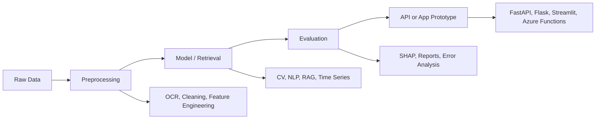

<div align="center">
  
</div>

<p align="center">
  <a href="https://github.com/Ditt-A">
    
  </a>
  <a href="https://www.linkedin.com/in/aditya-akkbbar/">
    
  </a>
  <a href="mailto:aditya.akkbbar@gmail.com">
    
  </a>
</p>

<p align="center">
  
  
  
</p>

---

## System Profile

```txt
> boot aditya-akbar.profile

role        : Computer Science undergraduate, applied AI builder
location    : Malang, Indonesia
education   : Universitas Brawijaya (2024–present)
lab         : Intelligent Systems Laboratory, FILKOM UB
community   : Data Scientist & Vice Head of Talent Development, BCC FILKOM UB
website     : https://www.adtyaakbr.my.id/

focus       : RAG systems, computer vision, NLP, time-series forecasting
builds      : source-grounded AI workflows, model experiments, interactive prototypes
```

<table>
<tr>
<td width="25%" align="center">

**6**

Highlighted AI projects

</td>
<td width="25%" align="center">

**6**

Competition results

</td>
<td width="25%" align="center">

**4**

Main AI domains

</td>
<td width="25%" align="center">

**Research**

IS Lab FILKOM UB

</td>
</tr>
</table>

---

## Core Stack

<p align="center">
  
</p>

| Track | Hard Skills |
| --- | --- |
| Machine Learning | Pandas, NumPy, Scikit-learn, LightGBM, CatBoost, SHAP, model evaluation |
| Deep Learning and CV | PyTorch, TensorFlow, Hugging Face Transformers, OpenCV, MONAI, Ultralytics, Mediapipe |
| NLP and LLM | RAG, BGE-M3, BM25, RRF, FAISS, PostgreSQL, Qwen3-VL, Gemini workflows |
| Backend and Deployment | FastAPI, Flask, React, TypeScript, Streamlit, Azure Functions, Docker basics, Git |

---

## Experience

<table>
<tr>
<td width="50%" valign="top">

### AI Engineer Intern

**PT Pertamina Patra Niaga**<br/>
Sep–Nov 2026

</td>
<td width="50%" valign="top">

### AI Engineer Intern

**AI Talent Factory (AITF), Komdigi**<br/>
Sep–Nov 2026

</td>
</tr>
</table>

---

## Competition Achievements

<table>
<tr>
<td width="33%" valign="top">

<p align="center">
  
</p>

### 1st Winner

**Data Science — Sebelas Maret Statistics Fair 2026**<br/>
Universitas Sebelas Maret · Sep 2026

First place in the Data Science competition.

`Data Science` `Machine Learning`

</td>
<td width="33%" valign="top">

<p align="center">
  
</p>

### Top 8 Semifinalist

**Datathon RISTEK UI 2026**<br/>
Universitas Indonesia · Aug 2026

City-network traffic forecasting, next-click prediction, and PasarPulse multimodal price-forecasting research.

`Forecasting` `Multimodal Data`

</td>
<td width="33%" valign="top">

<p align="center">
  
</p>

### 1st Honorable Mention

**International Data Science FIT Competition 2026**<br/>
Universitas Kristen Satya Wacana · Jul 2026

Machine learning and computer vision tasks, including survival analysis and mammogram classification.

`Data Science` `Computer Vision`

</td>
</tr>
<tr>
<td width="33%" valign="top">

<p align="center">
  
</p>

### Finalist

**Data Analytics Competition at Find IT! 2026**<br/>
Universitas Gadjah Mada · May 2026

Face spoofing detection for biometric security classification.

`Computer Vision` `Biometric Security`

</td>
<td width="33%" valign="top">

<p align="center">
  
</p>

### Top 7 Finalist

**Datavidia Arkavidia 10.0**<br/>
Institut Teknologi Bandung · Mar 2026

Multivariate time-series forecasting for ISPU category prediction.

`Time Series` `Forecasting` `ISPU`

</td>
<td width="33%" valign="top">

<p align="center">
  
</p>

### 12th Place

**Machine Learning Competition Data Slayer 3.0**<br/>
Telkom University · Dec 2025

Drowsiness detection using video-based machine learning.

`Machine Learning` `Video Analytics`

</td>
</tr>
</table>

---

## Project Console

<table>
<tr>
<td width="50%" valign="top">

### 🧠 [BrainTumourSegmentation](https://github.com/Ditt-A/BrainTumourSegmentation)

3D multimodal MRI segmentation with U-Net, U-Net++, and MedicalNet ResNet18, plus experiment reports and an interactive MRI/reference viewer.

`Medical Imaging` `Segmentation` `PyTorch`

</td>
<td width="50%" valign="top">

### 📚 [AMANA / DSNMUI_RAG](https://github.com/Ditt-A/DSNMUI_RAG)

Document-grounded DSN-MUI assistant with BGE-M3, BM25, RRF, reranking, optional Qwen3-VL visual reasoning, and a React/FastAPI prototype.

`RAG` `Hybrid Retrieval` `Qwen3-VL`

</td>
</tr>
<tr>
<td width="50%" valign="top">

### 🛡️ [Face-Spoofing-Detection](https://github.com/Ditt-A/Face-Spoofing-Detection)

Six-class face presentation-attack research using DINOv3, ConvNeXt, and FSFM, with an interactive dataset gallery and FastAPI reference demo.

`Computer Vision` `Anti-Spoofing` `Ensemble`

</td>
<td width="50%" valign="top">

### ✍️ [RobustIdentityCardOCR](https://github.com/Ditt-A/RobustIdentityCardOCR)

A team project for extracting names, birth dates, and addresses from varied identity documents using PP-OCRv6 and OpenOCR, with retained benchmark reports.

`OCR` `Document Understanding` `Computer Vision`

</td>
</tr>
<tr>
<td width="50%" valign="top">

### 🌫️ [Kalimantan FireWatch](https://github.com/Ditt-A/Kalimantan-FireWatch)

Decision-support dashboard for Kalimantan fire monitoring, combining satellite detections, geospatial context, incident prioritization, and response-planning support.

`Geospatial Data` `FastAPI` `Next.js`

</td>
<td width="50%" valign="top">

### 💭 [Senandika / AI-MoodBand](https://github.com/Ditt-A/AI-MoodBand)

Non-clinical Indonesian reflection app with Gemini, FAISS conversational memory, mood check-ins, daily summaries, and safety-aware response flows.

`Flask` `Gemini` `FAISS`

</td>
</tr>
</table>

---

## Build Map



---

## GitHub Stats

<p align="center">
  
  
</p>

<p align="center">
  
</p>

<p align="center">
  <a href="https://github.com/Ditt-A?tab=repositories">
    
  </a>
  <a href="https://github.com/Ditt-A?tab=stars">
    
  </a>
</p>

---

<p align="center">
  <strong>Building applied AI systems that turn messy real-world data into inspectable, source-grounded, and usable tools.</strong>
</p>
